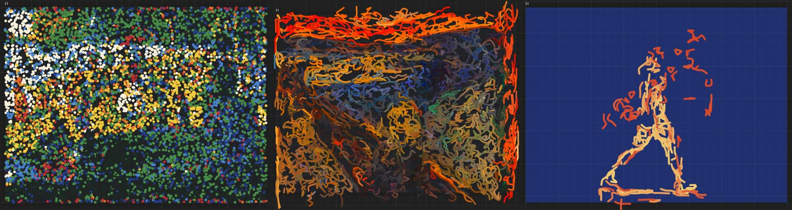
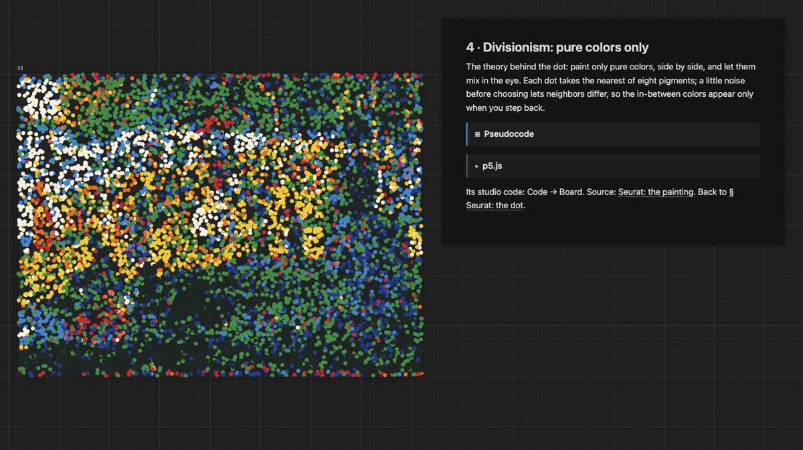
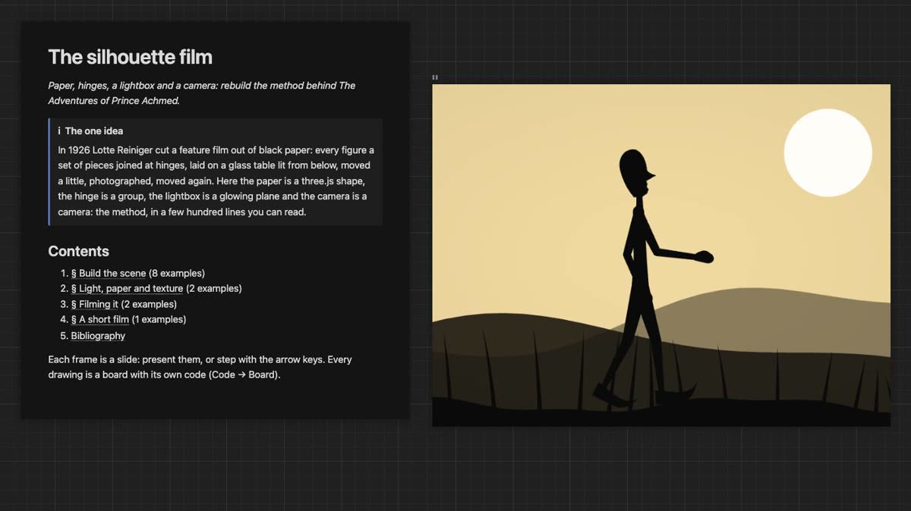
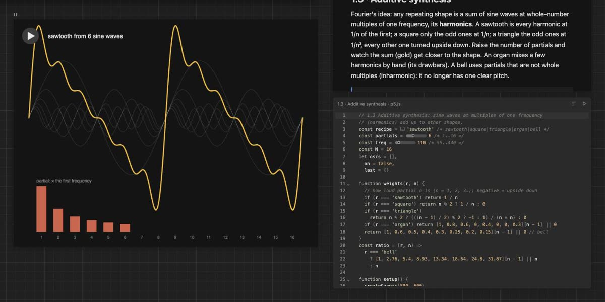
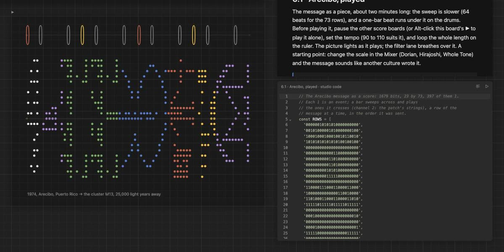
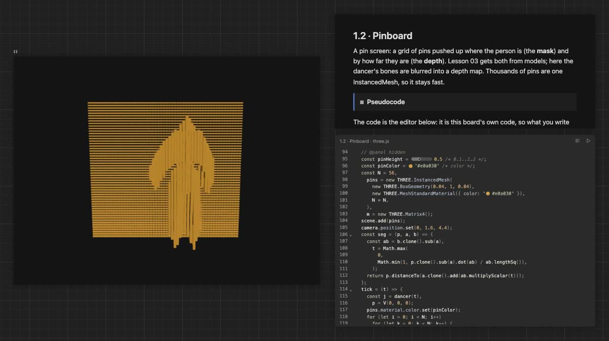
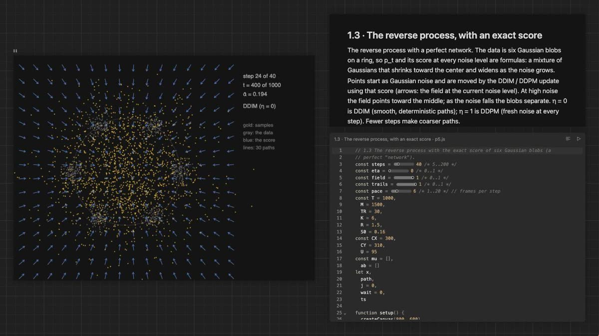

# Artist Model Studio (artmost)

**A creative environment for teaching and learning, for humans and machines alike.**

### ▶ [Open the studio](https://languel.github.io/artistmodelstudio/) · runs in your browser, nothing to install



Artist Model Studio, or artmost for short, is an infinite canvas where drawing, code, sound, motion and film live side by side, and where every piece of work keeps a record of **how it was made**. Boards hold drawings, p5.js and three.js sketches, synthesizers, physics and video; lessons are scenes of live boards you can read, run and change; anything can be presented as slides, recorded on a timeline, or published as a page.

What makes it unusual is who it is for. A student, a teacher, a language model and an AI agent all work here the same way: by writing small, readable programs and making visible decisions. So the studio is as much a place to *teach machines* (and to watch how they learn) as it is a place to teach people.

## Lessons

Build any lesson with one click (Docs → Lessons → *Build the scene*, or type `/lesson` in the command palette). Each is a scene of slides, and every picture, diagram and instrument on them is live code.

<table>
<tr>
<td width="50%"><br><b>Pointillism and Expressionism, by sampling</b><br>How the eye samples light, then Seurat, Munch and Muybridge as sources: sample a picture, decide what to draw there.</td>
<td width="50%"><br><b>The silhouette film</b><br>Rebuild Lotte Reiniger's method for <i>The Adventures of Prince Achmed</i>: lightbox, paper, hinges, a puppet, a layered set and a walk, in three.js.</td>
</tr>
<tr>
<td><br><b>Sound synthesis, from a sine wave to a band</b><br>What sound is (pressure, the voice, the ear), then waveforms, envelopes, filters, FM, scales, drums and sequencers; strings, bells, samples and grains in plain Web Audio.</td>
<td><br><b>Modular: patches, scores and pictures that listen</b><br>A modular synth drawn on the canvas, sequencers you can see, graphic scores (the Arecibo message among them) that play it, and sketches that move with the music.</td>
</tr>
<tr>
<td><br><b>Three.js for body and sound</b><br>From a spinning cube to a body you can play, dress, draw and paint with: a pin screen, a laser harp, a body drum, Schlemmer costumes. The full course: <a href="https://github.com/languel/threejslessons">threejslessons</a>.</td>
<td><br><b>Diffusion models, from noise to picture</b><br>How image models work, in diagrams and live simulations: the forward and reverse process, the schedule, sampling, guidance.</td>
</tr>
</table>

## What you can do here

- **Learn and teach with live material.** Lessons, walkthroughs that guide your cursor to the real controls, and exercises after Kandinsky, Klee and the early algorithmic artists, written for students and models alike.
- **Make with code you can see.** Drawings, brushes, sketches and instruments are short programs you can read, fork and change; numbers in code become sliders.
- **Mix media on one canvas.** Drawings, p5.js and three.js, a modular synthesizer, sound analysis that drives any parameter, 2D physics, images and video.
- **Present, record and publish.** Show boards as slides, record takes on a timeline with narration, music and cameras, and export a film or a single HTML page that replays the work.
- **Keep the process, not only the result.** Every mark and change keeps its order, its tool and the reason for it, so work can be replayed step by step, studied, and learned from.
- **Work with models and agents.** Language models write the same programs people do; an agent can drive every control through MCP, build scenes and make films; a small local model learns from your decisions.

## Why the name

The short name, artmost, comes from **Art**ist **Mo**del **St**udio. The project began with a research question: can a model learn to draw the way a person is taught to, through a staged, visible process of seeing, constructing and making marks, rather than producing a finished picture in one step? That question shaped the studio's core idea, that the record of *how* something was made is worth as much as the result. It has since grown into a general environment for creative teaching and learning, and the question is now one strand of many. The original thinking is in the [design note](docs/design.md).

## More

- **[Documentation](docs/README.md)**: getting started, the lessons, guides
- **[Technical overview](docs/technical.md)**: running it locally, architecture, the classic studio, engines and models, a map of every document
- **[Driving it from agents](docs/mcp.md)** (MCP)

Run it on your own machine:

```bash
npm install
npm run dev
```

MIT licensed. Bundled reference images are public domain; third-party licenses are listed in the [technical overview](docs/technical.md#licenses).
