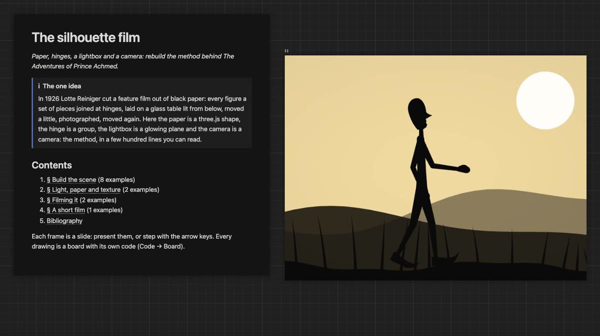
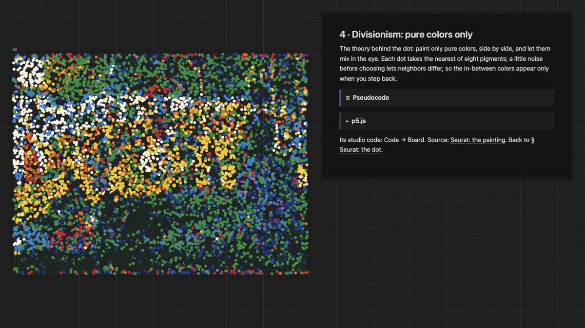
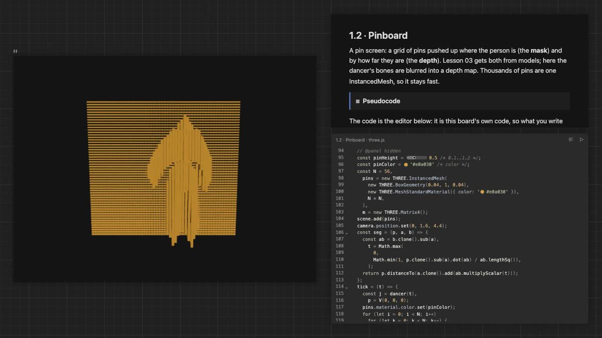
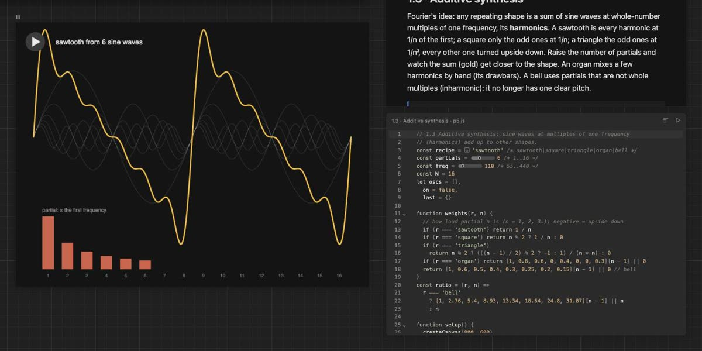
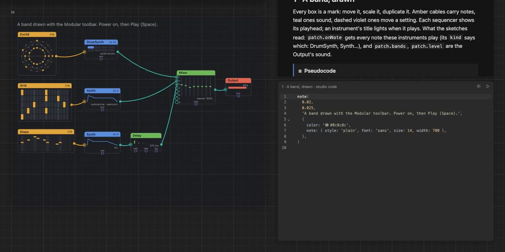
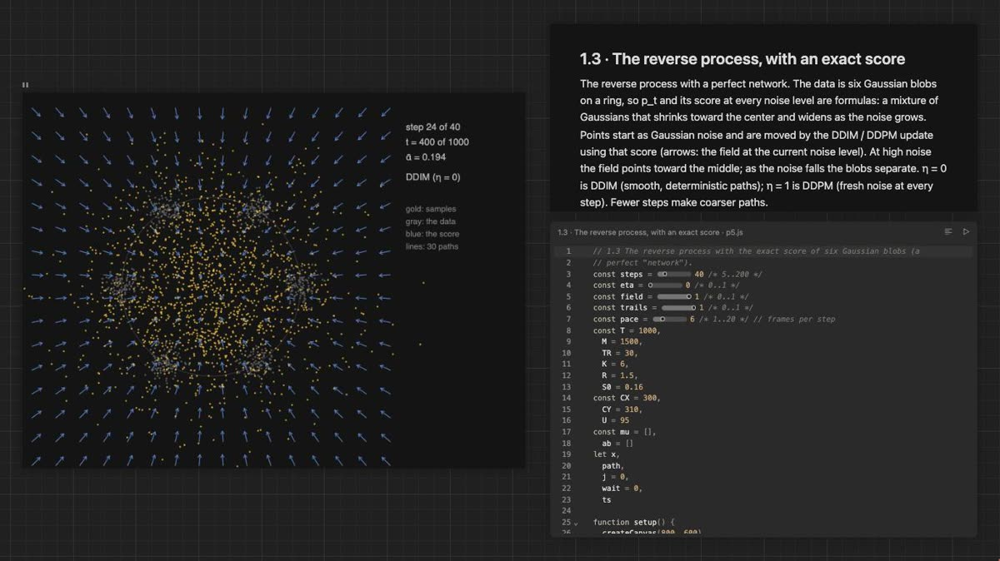

# Artist Model Studio (artmost): documentation

**[Open the studio](https://languel.github.io/artistmodelstudio/)** · [Back to the front page](../README.md) · [Technical overview](technical.md)

Artist Model Studio (artmost) is a creative environment for teaching and learning, for humans and machines. On one infinite canvas, boards hold drawings, p5.js and three.js sketches, a modular synthesizer, physics, images and video; lessons are scenes of these live boards; a timeline records and edits takes into films. Everything is written as short, readable programs and keeps a record of how it was made, so students, teachers, language models and agents can all work the same way, and anyone's process can be replayed, studied and learned from.

## Getting started

1. **[Open the studio](https://languel.github.io/artistmodelstudio/)** in a recent desktop browser (Chrome, Edge, Firefox or Safari). Nothing is uploaded: your scenes and assets stay in the browser.
2. Press **?** for the Docs panel. It holds the walkthroughs (the studio moves the cursor to the real controls and shows you), the Lessons, and a searchable reference.
3. **Cmd+K** (Ctrl+K) opens the command palette: every command, panel, exercise and lesson by name. Try `/lesson sampling`.
4. Draw on a board or run a sketch, then open the **Process** panel to replay what you did, step by step.

## Lessons

Each lesson builds a scene of slides; present it with **Play**, or wander the canvas. Every picture is live code.

| | Lesson | What it covers |
| --- | --- | --- |
|  | **Pointillism and Expressionism, by sampling** (`/lesson sampling`) | How the eye samples light; Seurat's dots, Munch's strokes and Muybridge's walker as sources for code that samples a picture and decides what to draw. Also as barebones p5.js. |
|  | **Three.js for body and sound** (`/lesson threejs`) | Ten three.js boards from a spinning cube to a body you can play: laser harp, body drum, costumes, one-line drawing, paint in space. The full course is [threejslessons](https://github.com/languel/threejslessons). |
|  | **The silhouette film** (`/lesson reiniger`) | Lotte Reiniger's method rebuilt step by step: lightbox, paper, hinges, a puppet, a layered set, two cameras and a walk. |
|  | **Sound synthesis** (`/lesson synthesis`, `/lesson webaudio`) | What sound is, then from a sine wave to a band in p5.sound; strings, bells, samples and granular synthesis in plain Web Audio; [Strings in the Air](https://languel.github.io/artistmodelstudio/demos/hand-strings.html), strings and drums you draw in the air and play with your hands and face (camera, MediaPipe). |
|  | **Modular** (`/lesson modular`, `/lesson visuals`) | A modular synth on the canvas, sequencers and graphic scores, and sketches that listen to it. |
|  | **Diffusion models** (`/lesson diffusion`) | How image models turn noise into pictures, in diagrams and simulations, with a bibliography. |

For teaching with the studio, see the [classroom demonstration guide](classroom-demo.md).

## Guides

- **[The workbench](workbench.md)**: every panel, tool and shortcut
- **[Quick commands](quick-commands.md)**: the `/` field and the command palette
- **[Films](films.md)**: lessons and explainers made with the camera and the Timeline
- **[Driving the studio from agents](mcp.md)**: MCP and WebMCP; an agent as the engine
- **[Embedding the editor](EMBEDDING.md)**: Poliplan, the drawing editor as a component for other pages

## The ideas

The project began as a research question (can a model learn to draw through a visible, staged process, the way people are taught?) and grew from there into a general teaching and learning environment.

- **[Design note](design.md)**: the original question, what we learned reproducing *Train to paint with code*, and the principles that still shape the studio
- **[Reference Fitter](reference-fitter.md)**: painting a reference with a budget of shapes, as an endless painting
- **[Experiments](experiments.md)** and the **[Klee distillation](../training/klee/README.md)**: small models trained on drawing programs

## For developers

Running locally, builds, architecture, the classic studio, engines, honest notes and a map of every document: **[technical overview](technical.md)**.
