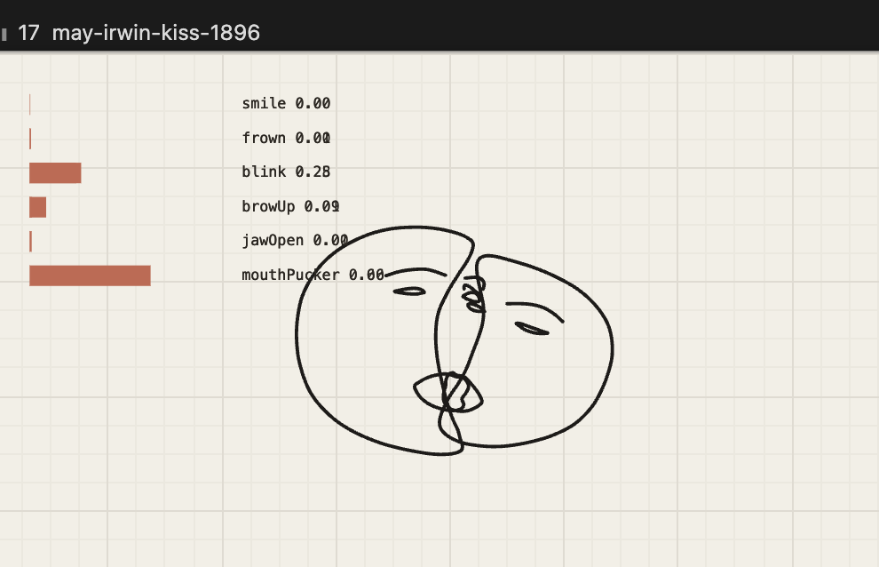

# Accidental art: the kiss as a unicursal face drawing

29 Sep 2026. The *Face and expressions* demo (board menu → *Draw from a source*) on the 1896 kiss clip drew two
overlapping abstract faces, one pen line each: outline, lips, eyes, brows. It reads as a stylized Picasso
one-line ("unicursal") drawing. Nobody drew it: the face model's 478 points, fitted to a grainy black and white
frame, placed the two faces on top of each other, so the outlines cross and the lips tangle.

Why it looks like that (to keep or to change):

- Each feature is one `line()` through landmark indices (oval, lips, eyes, brows) with the pen brush, smoothed.
- Two faces so close that their landmarks overlap: the crossing is what makes it read as one continuous line.
- The 3D face is fitted to a 2D picture, so features drift from the picture underneath; that drift is the style.

Idea to revisit: the user has been trying to recreate stylized Picasso unicursal drawings for some time in
`~/dev/sketchcam`, unsuccessfully; this may be a way in. Directions: one continuous line through the features
in a chosen order (real unicursal), a wobble or pressure taper on the pen, faces from a live camera, several
faces at different scales, the source hidden. The demo now has sliders for the underlay, the markers and the faces
(`/* 0..1 */` in its code).
